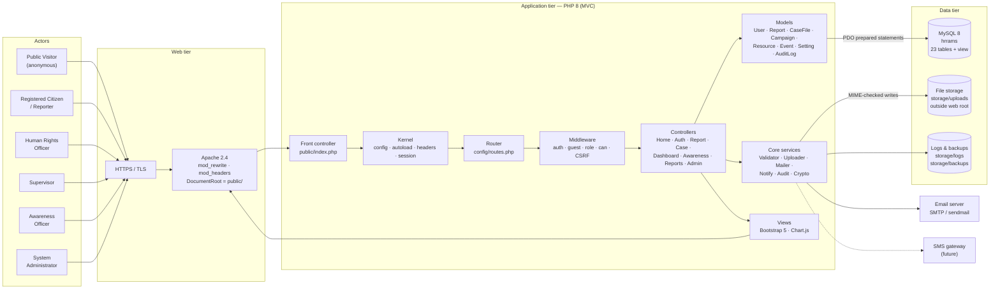
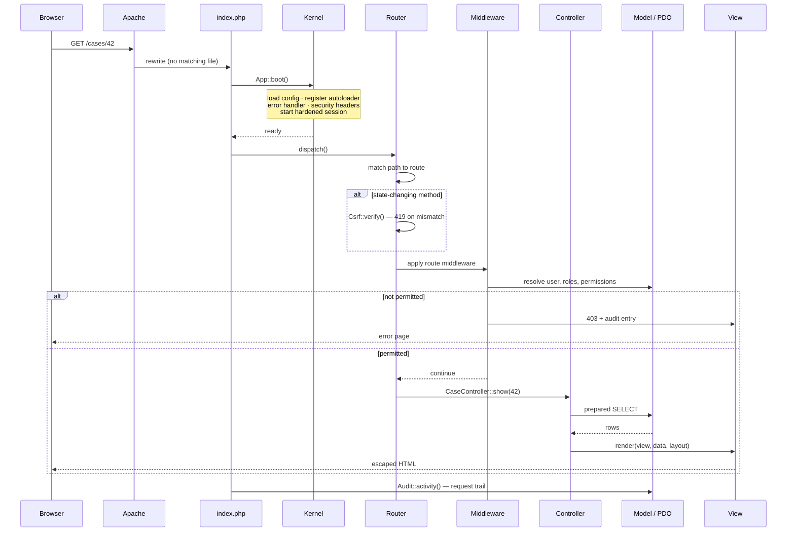
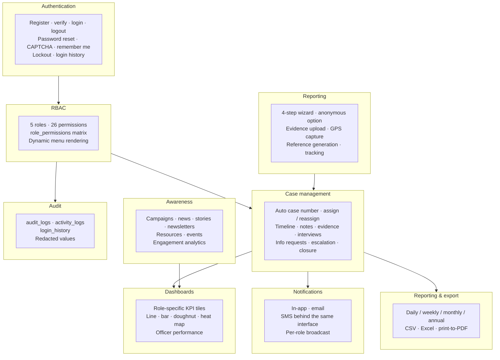
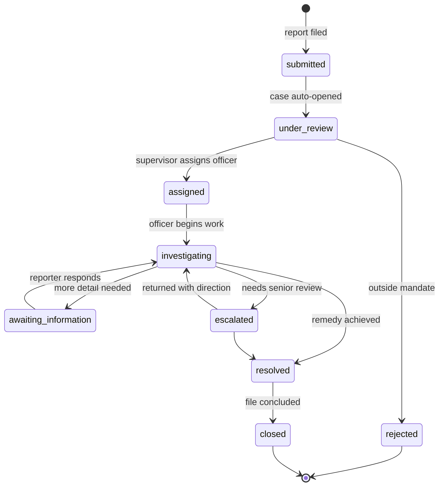
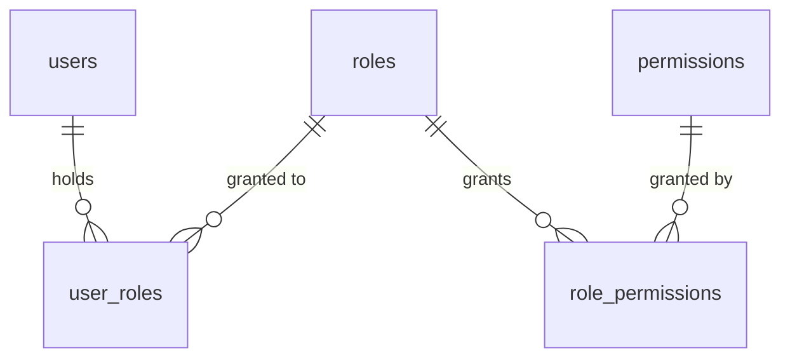

# System Architecture

## 1. Architecture diagram

Actors on the left, the application tiers in the middle, supporting services on the right.

### Why the tiers are split this way

- **Only `public/` is web-exposed.** Application code, configuration, evidence files, logs and
  backups all live above the document root. A misconfigured server cannot leak them, and an
  uploaded file cannot be executed because it is never inside a served directory.
- **One entry point.** Every request passes through `public/index.php`, so security headers,
  session hardening, CSRF verification and authorisation are guaranteed rather than
  remembered per-page.
- **Authorisation sits in middleware, before controllers.** A route declares the permission it
  needs; the controller is never reached without it.
- **Models own all SQL.** Controllers never build a query, so prepared statements are
  structurally enforced rather than a convention.

---

## 2. Request lifecycle

---

## 3. Layer responsibilities

| Layer | Files | Responsibility | Must not |
|---|---|---|---|
| Front controller | `public/index.php` | Boot the kernel, load helpers, dispatch | Contain business logic |
| Kernel | `app/Core/App.php` | Config, autoloading, error handling, security headers, base-URL detection | Touch the database |
| Session | `app/Core/Session.php` | Strict-mode sessions, fingerprint binding, idle timeout, id rotation | Store secrets |
| Router | `app/Core/Router.php` | Path matching, CSRF gate, middleware chain, dispatch | Query data |
| Middleware | `app/Core/Middleware.php` | Enforce `auth`, `guest`, `verified`, `role:`, `can:` | Render business views |
| Controllers | `app/Controllers/*` | Validate input, orchestrate models and services, choose a view | Write SQL or echo HTML |
| Models | `app/Models/*` | All data access via prepared statements; aggregation queries | Handle HTTP or render |
| Services | `app/Core/{Validator,Uploader,Mailer,Notify,Audit,Crypto}.php` | Cross-cutting concerns | Depend on a specific controller |
| Views | `app/Views/*` | Presentation only; every dynamic value through `e()` | Contain queries or business rules |

---

## 4. Module map

---

## 5. Case lifecycle

A case is opened automatically the moment a report is submitted, so nothing can sit
unrecorded. Its service deadline is derived from the urgency the reporter selected: critical
3 days, high 7, medium 14, low the configured default (30).

Only a holder of `case.close` — supervisor or administrator — may move a case to `resolved`,
`closed` or `rejected`. Officers can advance the investigative states but cannot conclude
their own cases.

---

## 6. Authorisation model

A user's effective permissions are the union of the permissions of all their roles, resolved
per request in `Auth::permissions()`. The same `can()` check drives both the middleware gate
and the visibility of menu items and buttons, so the interface never offers an action that
would be refused.

Additional record-level rules layer on top of permissions:

- An officer without `case.view_any` may only open cases where `cases.officer_id` is their own
  id — enforced in `CaseController::authorisedCase()`.
- A citizen may only open a report where `reports.reporter_user_id` is their own id.
- Evidence is released only to a user who holds a case-wide permission, owns the report, or is
  the assigned officer — enforced in `CaseController::mayViewAttachment()`.

Every refusal writes an `access.denied` audit entry.

---

## 7. Technology choices

| Concern | Choice | Reasoning |
|---|---|---|
| Framework | None; hand-rolled MVC | The brief specifies PHP 8 MVC. No Composer dependency keeps deployment to a file copy and removes a supply-chain surface. |
| Data access | PDO, prepared statements | Emulation disabled, so parameters are bound server-side. |
| Front end | Bootstrap 5.3 + custom CSS layer | Responsive grid, accessible components, dark mode via `data-bs-theme`. |
| Charts | Chart.js 4 | Canvas-based, small, theme-aware. Each chart also has a table equivalent for screen readers. |
| PDF export | Print-ready HTML | No binary dependency. `ReportsController::exportPdf()` is the single place to swap in Dompdf if server-side PDF becomes a requirement. |
| Excel export | Single-sheet HTML table with an `.xls` content type | Opens natively in Excel and LibreOffice with no library. |
| Passwords | `password_hash()` with bcrypt | Adaptive cost, salt handled by PHP. |
| Sensitive columns | AES-256-GCM via `Crypto` | Authenticated encryption — tampering is detected, not just hidden. |

---

## 8. Performance

- **Indexes** on every foreign key plus the columns actually filtered and sorted — status,
  category, province, urgency, `created_at`, `officer_id`, `deleted_at`.
- **Aggregation in SQL**, not PHP. Dashboard tiles come from single grouped queries
  (`Report::totals()`, `CaseFile::stats()`) rather than counting loops.
- **Pagination everywhere** a list can grow, with `LIMIT`/`OFFSET` bound to validated integers.
- **Charts load over AJAX** after first paint, with skeleton placeholders, so a slow
  aggregation never blocks the page.
- **One fetch feeds many charts** — `charts.js` groups canvases by endpoint.
- **`v_case_overview`** encapsulates the common five-table case join for reporting.
- **GZIP, `Expires` headers and lazy-loaded images** configured in `public/.htaccess`.
