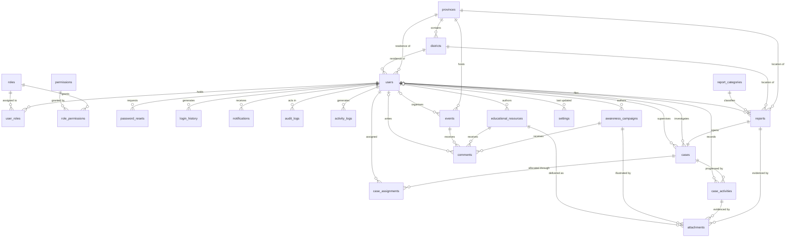

# Entity Relationship Diagram

Crow's-foot notation. `||--o{` reads "exactly one to zero-or-many"; `}o--||` the reverse.

## 1. Full model

## 2. Core attributes

```mermaid
erDiagram
    users {
        int id PK
        varchar first_name
        varchar last_name
        varchar email UK
        varchar phone
        varchar password_hash
        varbinary national_id_enc "AES-256-GCM"
        int province_id FK
        int district_id FK
        enum status "pending|active|suspended|locked"
        datetime email_verified_at
        char verify_token
        tinyint failed_attempts
        datetime locked_until
        datetime last_login_at
        char remember_token
        datetime created_at
        datetime updated_at
        datetime deleted_at "soft delete"
    }

    reports {
        bigint id PK
        varchar reference_no UK "HR-YYYY-NNNNNN"
        int reporter_user_id FK "NULL when anonymous"
        tinyint is_anonymous
        varchar reporter_name
        varchar reporter_email
        varchar reporter_phone
        int category_id FK
        int province_id FK
        int district_id FK
        varchar title
        text description
        date incident_date
        time incident_time
        varchar location
        decimal latitude
        decimal longitude
        text persons_involved
        varchar organization_involved
        smallint victim_count
        text witness_details
        enum urgency "low|medium|high|critical"
        tinyint consent_given
        enum status "9 states"
        datetime created_at
        datetime deleted_at
    }

    cases {
        bigint id PK
        varchar case_number UK "CASE-YYYY-NNNNN"
        bigint report_id FK,UK "1:1 with reports"
        int officer_id FK "current owner"
        int supervisor_id FK
        enum status "9 states"
        enum priority "low|medium|high|critical"
        datetime opened_at
        datetime due_at "SLA deadline"
        datetime resolved_at
        datetime closed_at
        text resolution_summary
        datetime deleted_at
    }

    case_activities {
        bigint id PK
        bigint case_id FK
        int user_id FK
        enum type "note|status_change|assignment|evidence|interview|information_request|finding|escalation|closure"
        varchar title
        text body
        varchar old_value
        varchar new_value
        datetime scheduled_at "interviews"
        tinyint is_internal "0 = visible to reporter"
        datetime created_at
    }

    attachments {
        bigint id PK
        enum entity_type "report|case_activity|campaign|resource|user"
        bigint entity_id
        varchar original_name
        varchar stored_name "randomised, outside web root"
        varchar mime_type "sniffed, not client-supplied"
        enum kind "image|video|audio|document|other"
        bigint size_bytes
        char checksum "SHA-256"
        int uploaded_by FK
        datetime created_at
    }

    audit_logs {
        bigint id PK
        int user_id FK
        varchar action
        varchar entity_type
        bigint entity_id
        varchar description
        json old_values "redacted"
        json new_values "redacted"
        varchar ip_address
        varchar user_agent
        datetime created_at
    }
```

## 3. Relationship notes

| Relationship | Cardinality | Design note |
|---|---|---|
| `reports` → `cases` | 1 : 1 | A unique key on `cases.report_id` guarantees one case file per complaint. Created in the same transaction as the report. |
| `users` → `reports` | 0..1 : 0..* | Nullable, because anonymous reports have no owner. `ON DELETE SET NULL` so removing an account never destroys the complaint. |
| `cases` → `users` (officer) | 0..1 : 0..* | Nullable while awaiting assignment. `ON DELETE SET NULL` keeps closed cases readable after staff leave. |
| `cases` → `case_assignments` | 1 : 0..* | Full reassignment history. The previous row's `unassigned_at` is stamped rather than the row being overwritten. |
| `cases` → `case_activities` | 1 : 0..* | Append-only timeline. `is_internal = 0` marks entries a complainant may see. |
| `attachments` → any entity | polymorphic | `(entity_type, entity_id)` with a composite index. Keeps one upload pipeline and one authorisation check for reports, case findings, campaign covers and resources. |
| `provinces` → `districts` | 1 : 0..* | Feeds the cascading select in the reporting wizard via `/api/districts/{province}`. |
| `roles` ↔ `permissions` | many : many | Resolved through `role_permissions`; a user's effective set is the union across their roles. |

## 4. Conventions applied to every table

- Surrogate integer primary key (`BIGINT UNSIGNED` where volume is expected).
- Foreign keys declared with explicit `ON DELETE` behaviour — `CASCADE` for owned children,
  `SET NULL` where history must outlive the parent.
- `created_at`, `updated_at`, and `created_by` / `updated_by` where a person is responsible.
- `deleted_at` for soft deletion; every model query filters `deleted_at IS NULL`. Audit and
  history tables are append-only and deliberately have no soft-delete column.
- Indexes on all foreign keys plus the columns the application actually filters and sorts on.
- `utf8mb4_unicode_ci` throughout, InnoDB engine, so transactions and referential integrity
  are available.
