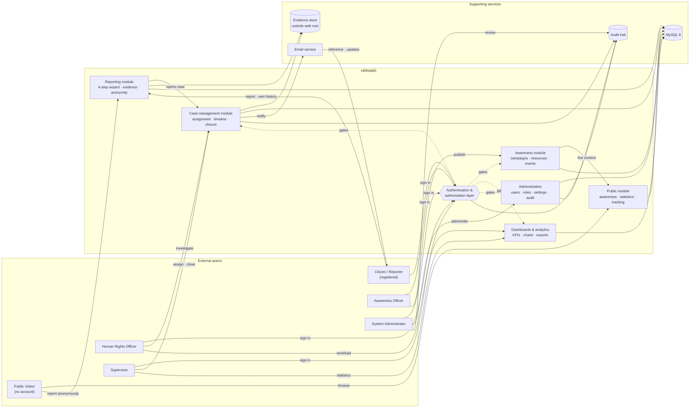
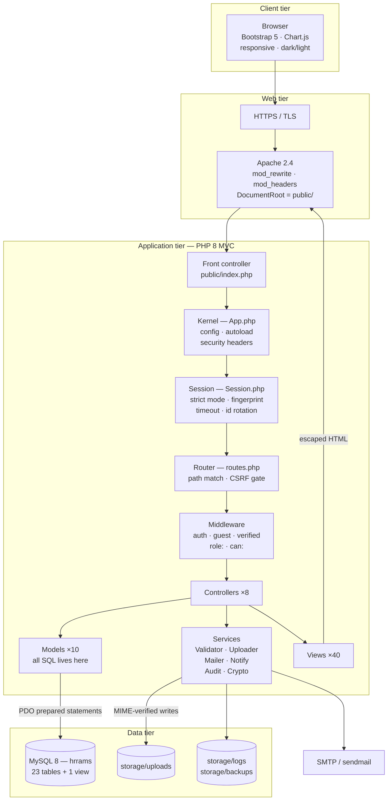
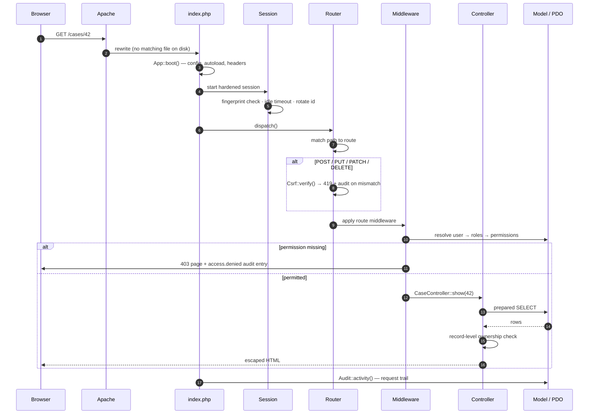
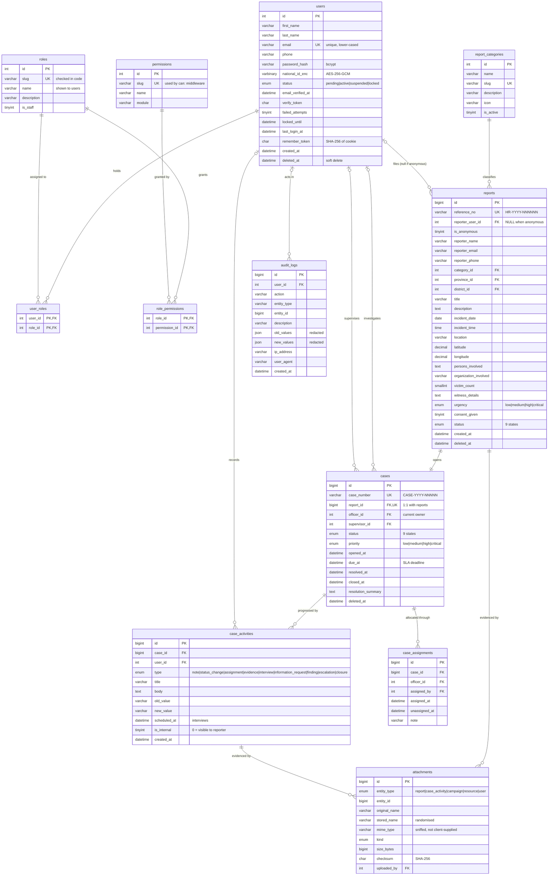
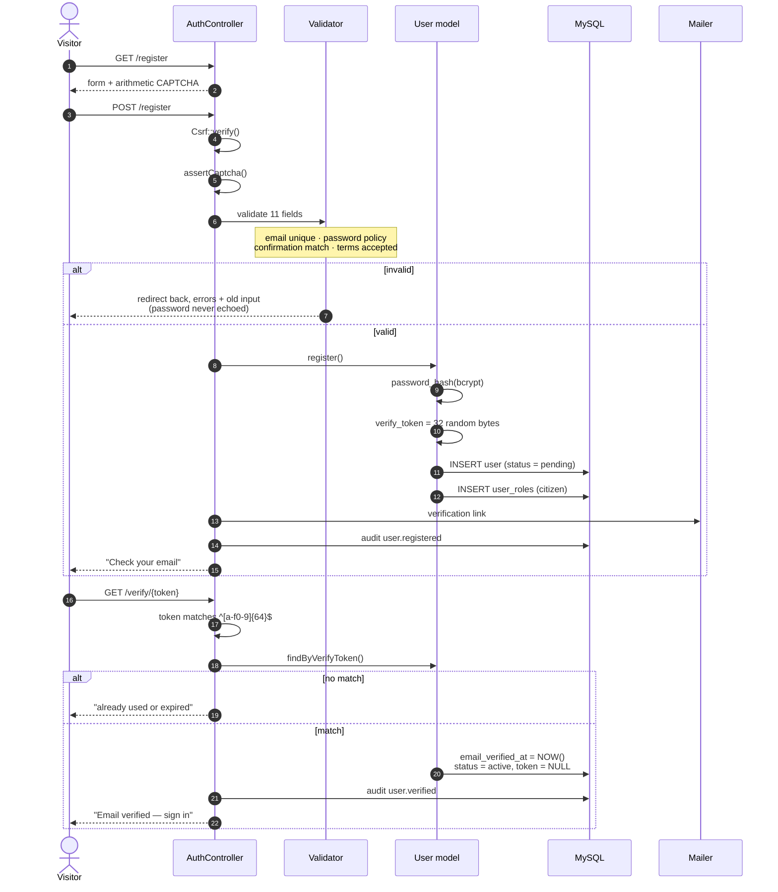
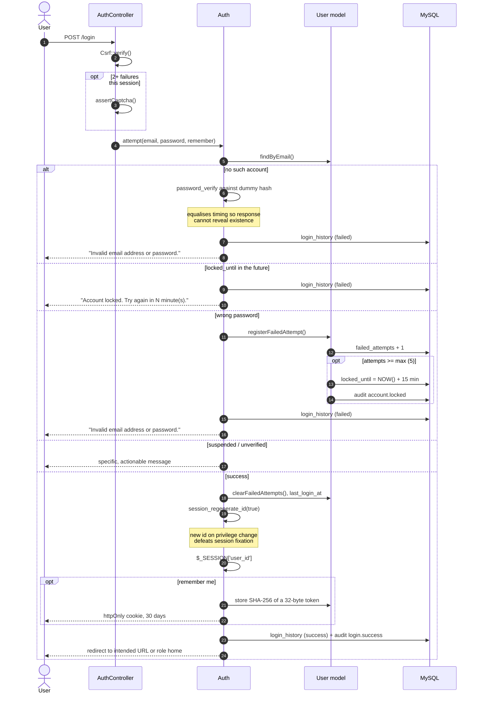
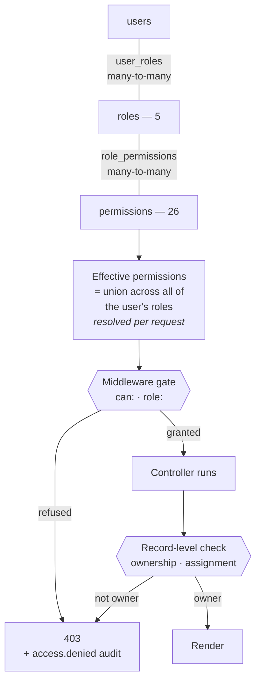
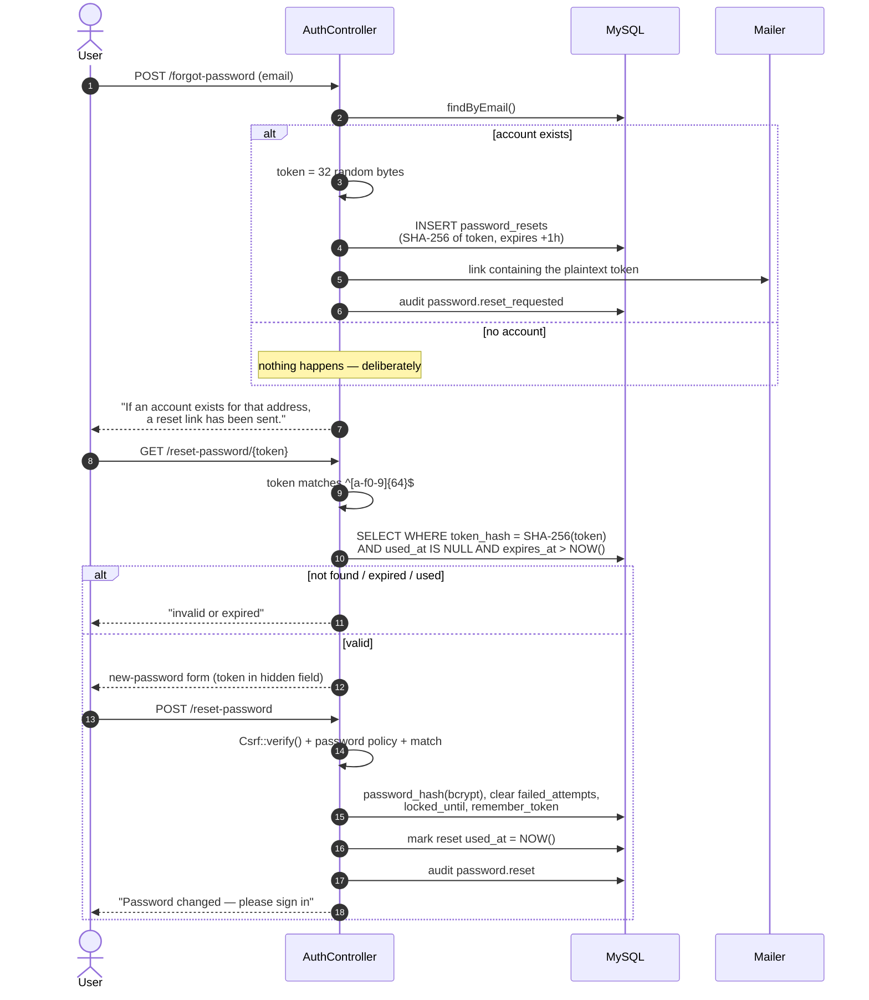
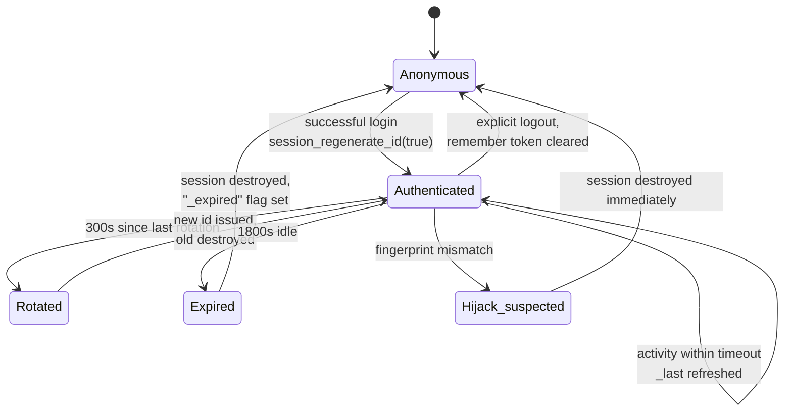

# System Design & Authentication

**HRRAMS — Human Rights Reporting & Awareness Management System**

This document covers the four deliverables of the System Design & Authentication phase:

| # | Deliverable | Section |
|---|---|---|
| i | System Architecture Diagram | [1](#1-system-architecture-diagram) |
| ii | Entity Relationship Diagram | [2](#2-entity-relationship-diagram) |
| iii | Wireframes (5 screens) | [3](#3-wireframes) |
| iv | Authentication System | [4](#4-authentication-system) |

Everything described here is implemented and has been exercised against a live
MySQL database. Section [5](#5-verification-evidence) lists what was tested and the
result. Section [6](#6-known-gaps) states, honestly, what is not yet built.

---

# 1. System Architecture Diagram

## 1.1 Actor interaction

Who does what, and which part of the system answers them. Anonymous reporting is a
first-class path: a citizen never has to hold an account to raise a complaint.



### What each actor may do

| Actor | Authentication | Capabilities |
|---|---|---|
| **Public Visitor** | none required | Browse campaigns, news, resources and events; read aggregate statistics; **file a report anonymously**; track any report by its reference number |
| **Citizen / Reporter** | account, email-verified | Everything a visitor can, plus a history of their own reports, a per-report timeline of shared updates, printable acknowledgement receipts, profile management and notifications |
| **Human Rights Officer** | account + `officer` role | Investigate the cases assigned to them: case notes, evidence and findings upload, interview scheduling, information requests, investigative status changes. Cannot open another officer's case, and cannot conclude their own |
| **Supervisor** | account + `supervisor` role | Assign and reassign cases with live workload figures, escalate, approve, resolve, close or reject; departmental statistics and officer performance reporting |
| **Awareness Officer** | account + `awareness` role | Create and publish campaigns, news, articles, success stories, newsletters, educational resources and community events; engagement analytics |
| **System Administrator** | account + `admin` role | All of the above, plus user and role management, the permission matrix, report categories, system settings, the full audit log and database backup |

**Three things this diagram is meant to make obvious.**

A public visitor reaches the reporting module *without* passing through
authentication — that is deliberate, because requiring an account to report a
violation excludes exactly the people most likely to need the service. Everything
else protected passes through the authentication and authorisation layer first.
And a report never sits loose: submitting one opens a case file in the same
database transaction, so nothing can be received and then forgotten.

## 1.2 Technical architecture

The same system by tier, showing where each responsibility physically lives.



**Only `public/` is web-exposed.** Application code, configuration, evidence files,
logs and backups all sit *above* the document root, each with its own `.htaccess`
denying HTTP access. Two consequences matter: a server misconfiguration cannot
leak source or credentials, and an uploaded file can never be executed because it
is never inside a served directory.

**One entry point.** Every request goes through `public/index.php`, so security
headers, session hardening, CSRF verification and authorisation are structural
rather than something each page has to remember.

## 1.3 Request lifecycle



Note step ordering: **CSRF is verified before middleware, and authorisation before
the controller runs.** A route cannot forget either, because neither is the
controller's job.

---

# 2. Entity Relationship Diagram

Crow's-foot notation. `||--o{` reads "exactly one to zero-or-many".

## 2.1 Core entities

The entities named in the deliverable — users, roles, reports, cases, categories,
case activities and audit logs — with their attributes.



## 2.2 The remaining tables

The eleven entities above are the operational core. The full schema is 23 tables;
the rest fall into four groups:

| Group | Tables | Role |
|---|---|---|
| **Authentication support** | `password_resets`, `login_history` | Hashed single-use reset tokens; a record of every sign-in attempt |
| **Geography** | `provinces`, `districts` | Reference data for the cascading location selects. `districts` is a child of `provinces`, unique per `(province_id, name)` |
| **Awareness content** | `awareness_campaigns`, `educational_resources`, `events`, `comments` | Published campaigns, news, stories and newsletters; downloadable resources; community events; moderated comments |
| **Operations** | `notifications`, `activity_logs`, `settings` | In-app messages; a per-request trail; runtime configuration as typed key/value |

Plus the reporting view **`v_case_overview`**, which encapsulates the five-table
case join (case → report → category → province → officer) and computes `age_days`,
so ad-hoc reporting does not restate that join.

A single diagram of all 23 tables is legible only at poster size — rendered at page
width the relationship labels collapse into noise. The complete ER model, split so
it stays readable, is in **[ERD.md](ERD.md)**; the column-level reference is in
**[DATABASE.md](DATABASE.md)**.

## 2.3 Design decisions worth defending

| Decision | Reasoning |
|---|---|
| `reports` → `cases` is **1:1**, enforced by a unique key on `cases.report_id` | Guarantees every complaint has exactly one case file. Both rows are created in one transaction, so a report can never exist unhandled. |
| `reports.reporter_user_id` is **nullable** | Anonymous reports have no owner by design. `ON DELETE SET NULL` means deleting an account never destroys the complaint. |
| `cases.officer_id` is **nullable**, `ON DELETE SET NULL` | A case exists before it is assigned, and closed cases stay readable after staff leave. |
| `case_assignments` keeps **history** rather than being overwritten | Reassignment stamps `unassigned_at` and inserts a new row, preserving the chain of custody. |
| `case_activities` is **append-only** | The timeline *is* the case file. `is_internal = 0` marks the entries a complainant may see. |
| `attachments` is **polymorphic** on `(entity_type, entity_id)` | One upload pipeline and one authorisation check serve reports, case findings, campaign covers and resources. |
| Roles ↔ permissions is **many-to-many** | A user may hold several roles; effective permissions are the union, resolved per request. |
| **Soft delete** (`deleted_at`) on business tables | Investigative and audit history must outlive an account. Audit/history tables are append-only and deliberately have *no* `deleted_at`. |
| Sensitive identifiers in **`VARBINARY`**, AES-256-GCM | Authenticated encryption, so tampering is detected rather than silently accepted. |

Normalised to **third normal form**. Every foreign key is indexed, plus the
columns actually filtered and sorted on: `status`, `category_id`, `province_id`,
`urgency`, `created_at`, `officer_id`, `deleted_at`.

Full column-by-column reference: [DATABASE.md](DATABASE.md).

---

# 3. Wireframes

Five screens, as specified. Layouts are annotated with responsive behaviour and
the permission that controls each region. Breakpoints follow Bootstrap:
`sm` 576, `md` 768, `lg` 992, `xl` 1200.

## 3.1 Public awareness page

`app/Views/awareness/list.php` — serves Campaigns, News and Success stories.

```
┌──────────────────────────────────────────────────────────────────────────────┐
│ [◆ HRRAMS]  Campaigns Resources News Events Statistics Track  [Report ▸] [🌙] │
├──────────────────────────────────────────────────────────────────────────────┤
│ ┌──────────────────────────────────────────────────────────────────────────┐ │
│ │ ░░░ full-bleed photograph, bottom-up scrim for caption contrast ░░░      │ │
│ │                                                                          │ │
│ │  ◦ AWARENESS                                                             │ │
│ │  Awareness campaigns                                                     │ │
│ │  Community programmes promoting knowledge of human rights across all      │ │
│ │  ten provinces.                                                          │ │
│ └──────────────────────────────────────────────────────────────────────────┘ │
│                                                                              │
│  ┌───────────────────┐ ┌───────────────────┐ ┌───────────────────┐          │
│  │ [Campaign] 14 Aug │ │ [Campaign] 14 Aug │ │ [News]     12 Aug │          │
│  │                   │ │                   │ │                   │          │
│  │ Know Your Rights: │ │ Every Child Has   │ │ Commission Opens  │          │
│  │ 16 Days of        │ │ a Right to School │ │ Three New         │          │
│  │ Activism          │ │                   │ │ Provincial Desks  │          │
│  │                   │ │                   │ │                   │          │
│  │ A nationwide      │ │ Community         │ │ Reporting desks   │          │
│  │ campaign against  │ │ outreach on the   │ │ are now open in   │          │
│  │ gender-based      │ │ right to free     │ │ Muchinga, North-  │          │
│  │ violence…         │ │ basic education…  │ │ Western, Western  │          │
│  │                   │ │                   │ │                   │          │
│  │ Read more →       │ │ Read more →       │ │ Read more →       │          │
│  │        📅 25 Nov  │ │        📅 01 Mar  │ │                   │          │
│  └───────────────────┘ └───────────────────┘ └───────────────────┘          │
│         ↑ lifts 3px on hover, whole card is the link                        │
│                                                                              │
│  … 3 per row on lg, 2 on md, 1 on sm                                        │
├──────────────────────────────────────────────────────────────────────────────┤
│  Has your right been violated?                          [ Report now ]       │
│  You can file a report in a few minutes, anonymously if you prefer.          │
├──────────────────────────────────────────────────────────────────────────────┤
│  FOOTER — brand · hotline · Report · Learn · About · Account                  │
└──────────────────────────────────────────────────────────────────────────────┘
```

**Empty state.** When nothing is published the grid is replaced by a single card:
an icon, "Nothing has been published here yet", and "Please check back soon" — never
a blank page.

**Detail view** (`awareness/show.php`) adds a type badge, publication date, author,
campaign date range, view count, the body, a "Report now" call to action, and three
related items.

**Responsive.** Banner height clamps between 180 px and 300 px. Card grid steps
3 → 2 → 1. Navbar collapses to a hamburger below `lg`, with "Report a violation"
staying visible because it is the page's real purpose.

## 3.2 Login page

`app/Views/auth/login.php`, layout `app/Views/layouts/auth.php`.

```
┌───────────────────────────────────┬──────────────────────────────────────────┐
│ ░░ photograph under brand wash ░░ │  ← Back to site                     [🌙] │
│                                   │                                          │
│  [◆] Human Rights Commission      │  Welcome back                            │
│                                   │  Sign in to manage reports, cases and    │
│  Every right deserves             │  campaigns.                              │
│  a voice.                         │                                          │
│                                   │  Email address *                         │
│  A secure platform for            │  ┌─────────────────────────────────────┐ │
│  reporting violations,            │  │ ✉  you@example.org                  │ │
│  tracking investigations          │  └─────────────────────────────────────┘ │
│  and building awareness           │                                          │
│  across every province.           │  Password *        Forgot password?      │
│                                   │  ┌──────────────────────────────┬──────┐ │
│  🔒 Encrypted submissions         │  │ 🔒 ••••••••••                │  👁  │ │
│  👁 Anonymous supported           │  └──────────────────────────────┴──────┘ │
│  🕘 Transparent tracking          │                                          │
│  👥 Awareness programmes          │  ┌── after 2 failed attempts ──────────┐ │
│                                   │  │ Security question: What is 4 + 7?   │ │
│  [ Report without an account ]    │  │ [____]                              │ │
│                                   │  └─────────────────────────────────────┘ │
│                                   │                                          │
│                                   │  ☐ Keep me signed in on this device      │
│                                   │  [          Sign in          ]           │
│                                   │  No account yet? Create one              │
│                                   │  ────────────────────────────────────    │
│                                   │  👁 You do not need an account to report │
│                                   │     Anyone can file a report,            │
│                                   │     anonymously if they prefer.          │
│                                   │     [ Report a violation ]               │
└───────────────────────────────────┴──────────────────────────────────────────┘
```

**Deliberate choices.** The CAPTCHA appears only after two failed attempts in the
session, so ordinary users never meet it. It is an arithmetic question rather than
an image — accessible, and no third-party service. The panel at the bottom exists
because the most common reason someone lands here is a mistaken belief that they
need an account to report; it redirects them in one click.

**Responsive.** The branding panel is `display:none` below `lg`; the form centres
with a 27 rem cap. The same layout serves register, forgot-password and reset.

## 3.3 Human-rights reporting form

`app/Views/report/create.php` — a four-step wizard, submitted as a single POST.

```
┌──────────────────────────────────────────────────────────────────────────────┐
│                    ◦ CONFIDENTIAL SUBMISSION                                 │
│              Report a human rights violation                                 │
│   Take your time. Only the category, a title, a description and your          │
│   consent are required — everything else helps but can be left blank.         │
├──────────────────────────────────────────────────────────────────────────────┤
│ ━━━━━━━━━━━━━━━  ──────────────  ──────────────  ──────────────              │
│ 1. Who is        2. The          3. Evidence     4. Review &                 │
│    reporting        incident                        submit                   │
├──────────────────────────────────────────────────────────────────────────────┤
│ ▸ STEP 1 — WHO IS REPORTING                                                  │
│  ┌────────────────────────────────────────────────────────────────────────┐  │
│  │ (●──) Report anonymously                                               │  │
│  │ With this on, no name, phone, email or address is stored with your     │  │
│  │ report. You will still get a reference number to track it — write it   │  │
│  │ down, because we will have no way to contact you or recover it.        │  │
│  └────────────────────────────────────────────────────────────────────────┘  │
│  Full name *            │ Phone number      ← whole block hides when          │
│  Email address          │ Nationality         anonymous is switched on,       │
│  Address                                      and its required flags drop     │
├──────────────────────────────────────────────────────────────────────────────┤
│ ▸ STEP 2 — THE INCIDENT                                                      │
│  Short title * ·························· │ Urgency * [Medium ▾]              │
│  Category of violation * [ ▾ 12 categories ]                                 │
│  What happened? * ┌───────────────────────────────────────────────────────┐  │
│                   │ (7 rows, minimum 30 characters)                       │  │
│                   └───────────────────────────────────────────────────────┘  │
│  Date [        ] │ Time [        ] │ Number of victims [ 1 ]                 │
│  Province [ ▾ ] ──AJAX──▸ District [ ▾ ]                                     │
│  Specific location ·······································                    │
│  ┌── GPS coordinates (optional) ─────────── [ Use my current location ] ───┐  │
│  │ Latitude ············   Longitude ············                          │  │
│  │ Only shared with the officer handling your case.                        │  │
│  └────────────────────────────────────────────────────────────────────────┘  │
│  Persons involved │ Organisation involved │ Witness details                  │
├──────────────────────────────────────────────────────────────────────────────┤
│ ▸ STEP 3 — EVIDENCE                                                          │
│  ┌╌╌╌╌╌╌╌╌╌╌╌╌╌╌╌╌╌╌╌╌╌╌╌╌╌╌╌╌╌╌╌╌╌╌╌╌╌╌╌╌╌╌╌╌╌╌╌╌╌╌╌╌╌╌╌╌╌╌╌╌╌╌╌╌╌╌╌╌╌╌┐  │
│  ╎                          ☁ upload                                     ╎  │
│  ╎            Drop files here, or click to browse                        ╎  │
│  ╎   JPG PNG WEBP GIF · MP4 MOV · MP3 WAV · PDF DOC DOCX                 ╎  │
│  ╎          up to 10 files, 20 MB each                                   ╎  │
│  └╌╌╌╌╌╌╌╌╌╌╌╌╌╌╌╌╌╌╌╌╌╌╌╌╌╌╌╌╌╌╌╌╌╌╌╌╌╌╌╌╌╌╌╌╌╌╌╌╌╌╌╌╌╌╌╌╌╌╌╌╌╌╌╌╌╌╌╌╌╌┘  │
│  (📎 clinic-report.pdf 1.2 MB) (📎 photo.jpg 0.8 MB)              Clear     │
│  ⚠ Never put yourself at risk to gather evidence. A report without any        │
│    attachments is still investigated.                                        │
├──────────────────────────────────────────────────────────────────────────────┤
│ ▸ STEP 4 — REVIEW & SUBMIT                                                   │
│  ┌────────────────────────────────────────────────────────────────────────┐  │
│  │ Reported by      Category           Urgency        Incident date       │  │
│  │ Joseph Tembo     Labour Rights      High           2026-07-14          │  │
│  │ Province         District           Location       Evidence files      │  │
│  │ Southern         Choma              Choma market   2 attached          │  │
│  └────────────────────────────────────────────────────────────────────────┘  │
│  ☐ Consent declaration * — I confirm this information is true to the best     │
│    of my knowledge, and consent to it being processed and, where necessary,   │
│    shared with the officers and authorities required to investigate it.       │
│  ℹ On submission you receive a reference such as HR-2026-000123.             │
├──────────────────────────────────────────────────────────────────────────────┤
│  [ ← Back ]                              Cancel  [ Continue → ] / [ Submit ] │
└──────────────────────────────────────────────────────────────────────────────┘
```

**Behaviour.** Each step is validated with the HTML5 constraint API before the user
can advance, so nobody is told about an error on a step they cannot see. Every rule
is then re-checked server-side — the client validation is convenience, not
security. The review panel is rebuilt from live field values on entry to step 4.
The whole wizard is one POST, so there is no partial server-side state to lose.

## 3.4 Officer dashboard

`app/Views/dashboard/index.php`, layout `app/Views/layouts/app.php`.

```
┌───────────────┬──────────────────────────────────────────────────────────────┐
│ [◆ HRRAMS]    │ ⌂ / Dashboard    [🔍 search…] [🔔³] [🌙] [DP Daniel Phiri ▾] │
│               ├──────────────────────────────────────────────────────────────┤
│ OVERVIEW      │ Good morning, Daniel                                         │
│ ▸ Dashboard   │ Friday, 14 August 2026 · Officer dashboard                   │
│               │                                                              │
│ CASE WORK     │ ┌──────┐┌──────┐┌──────┐┌──────┐┌──────┐                     │
│ ▸ My cases    │ │  14  ││   3  ││   1  ││  38  ││ 21 d │  each tile links to │
│ ▸ Overdue     │ │Active││Over- ││Escal-││Conc- ││ Avg. │  a filtered case    │
│               │ │cases ││ due  ││ated  ││luded ││resol.│  list              │
│ MY ACCOUNT    │ └──────┘└──────┘└──────┘└──────┘└──────┘                     │
│ ▸ My reports  │ ┌─────────────────────────────────┬────────────────────────┐ │
│ ▸ My profile  │ │ REPORT VOLUME, LAST 12 MONTHS   │ ⚠ NEEDS ATTENTION NOW  │ │
│               │ │      ╱╲    ╱╲                   │ • Unlawful detention   │ │
│ [+ New report]│ │  ╱╲╱  ╲╱╲╱  ╲╱╲                 │   CASE-2026-00031 41 d │ │
│               │ │ ╱                ╲              │ • Unpaid wages         │ │
│               │ └─────────────────────────────────┤   CASE-2026-00028 36 d │ │
│               │ ┌───────────────┬───────────────┐ ├────────────────────────┤ │
│               │ │ BY CATEGORY   │  BY STATUS    │ │ 📅 UPCOMING INTERVIEWS │ │
│               │ │ ▄▄▄▄▄▄▄▄      │      ◕        │ │ [14 AUG] Complainant   │ │
│               │ │ ▄▄▄▄▄         │   doughnut    │ │ 09:00 CASE-2026-00031  │ │
│               │ │ ▄▄▄           │               │ │ [16 AUG] Site witness  │ │
│               │ └───────────────┴───────────────┘ ├────────────────────────┤ │
│               │ ┌─────────────────────────────────┤ 🔔 NOTIFICATIONS       │ │
│               │ │ MY OPEN CASES                   │ • New case assigned    │ │
│               │ │ Case │Subject│Pri│Status│Age    │ │ • Info received       │ │
│               │ │ ─────┼───────┼───┼──────┼────   │ ├────────────────────────┤ │
│               │ │ …8 rows, row click → case…      │ │ LATEST REPORTS         │ │
│               │ └─────────────────────────────────┴────────────────────────┘ │
└───────────────┴──────────────────────────────────────────────────────────────┘
```

**Role-shaped.** An officer sees only their own workload — the same view for a
supervisor adds an "Unassigned" tile and a "Team workload" table, because
`case.assign` and `dashboard.department` are present. The sidebar is built from
the same `can()` checks that gate the routes, so the navigation never offers an
action the user would be refused.

**"Needs attention now" is placed first on the right** because it is the one panel
that should change what the officer does next.

**Responsive.** Sidebar becomes an off-canvas drawer below `lg` (hamburger,
backdrop, Esc to close). KPI tiles wrap 5 → 2 per row. The right column stacks
under the charts below `xl`. Charts load over AJAX with shimmer skeletons, so a
slow aggregation never blocks the page.

## 3.5 Case management page

`app/Views/cases/show.php` — the main working surface.

```
┌──────────────────────────────────────────────────────────────────────────────┐
│ ← Back to cases                                                              │
│ Unlawful detention at Kanyama police post        [High priority] [ASSIGNED]   │
│ Case CASE-2026-00031 · Report HR-2026-000117 · Opened 03 Jul 2026            │
├──────────────────────────────────────────────────────────────────────────────┤
│ 🔔 This case passed its service deadline on 10 Jul 2026. Record progress or   │
│    escalate it.                                                              │
├─────────────────────────────────────────────┬────────────────────────────────┤
│ THE COMPLAINT                               │ ASSIGNMENT                     │
│ Two family members were held for four days  │ (DP) Daniel Phiri              │
│ without charge and without access to a      │      officer@hrrams.test       │
│ lawyer. No warrant was produced.            │ Supervisor   Grace Mulenga     │
│ ─────────────────────────────────────────── │ Due by       10 Jul 2026       │
│ Category        │ Incident date & time      │ ────────────────────────────── │
│ Arbitrary Arrest│ 02 Jul 2026 · 21:30       │ Assign to [ ▾ ] (3 open)       │
│ Location        │ GPS coordinates           │ Instruction ················   │
│ Kanyama post    │ -15.4310, 28.2650 → map   │ [     Assign case     ]        │
│ Victims  2      │ Organisation  ZP Kanyama  │        ↑ can:case.assign only  │
│ Persons involved / Witness details          ├────────────────────────────────┤
├─────────────────────────────────────────────┤ COMPLAINANT                    │
│ RECORD AN ACTION                            │ Name    Joseph Tembo           │
│ ┌────────┬────────┬─────────┬──────┬──────┐ │ Email   joseph@example.org     │
│ │Case    │Upload  │Schedule │Req.  │Change│ │ Phone   +260 97 000 0005       │
│ │note    │findings│interview│info  │status│ │ 🔒 Every view is audit-logged. │
│ └────────┴────────┴─────────┴──────┴──────┘ │    (or: "Filed anonymously —   │
│  ↑ each tab shown only if the permission     │     cannot be contacted")     │
│    is held; officer sees 5, supervisor 3    ├────────────────────────────────┤
│ ┌─────────────────────────────────────────┐ │ EVIDENCE                    ③  │
│ │ Heading ······························· │ │ 📄 clinic-report.pdf  1.2 MB   │
│ │ Note *  ┌────────────────────────────┐  │ │ 🖼 photo.jpg          0.8 MB   │
│ │         │                            │  │ │ 🎵 statement.mp3      3.1 MB   │
│ │         └────────────────────────────┘  │ │    ↑ streamed only to          │
│ │ ☐ Visible to the complainant  [+ Add]   │ │      authorised users          │
│ └─────────────────────────────────────────┘ ├────────────────────────────────┤
├─────────────────────────────────────────────┤ RESOLUTION                     │
│ CONCLUDE THE CASE                       [⌄] │ (shown once concluded)         │
│  Outcome [Resolved ▾]  ← can:case.close     │                                │
│  Resolution summary * (min 20 chars,        │                                │
│  shared with the complainant)                │                                │
├─────────────────────────────────────────────┴────────────────────────────────┤
│ INVESTIGATION TIMELINE                                          6 entries    │
│ ●─ Status changed to Investigating           Daniel Phiri · 05 Jul 10:12     │
│ │   [Assigned] → [Investigating]                                            │
│ ●─ Interview scheduled              [Shared] Daniel Phiri · 04 Jul 16:40     │
│ │   📅 Scheduled for 14 Aug 2026, 09:00                                      │
│ ●─ Evidence uploaded: medical report         Daniel Phiri · 04 Jul 11:20     │
│ ●─ Case assigned                             Grace Mulenga · 03 Jul 09:05    │
│    ↑ dot colour encodes entry type                                           │
└──────────────────────────────────────────────────────────────────────────────┘
```

**Separation of duties is visible in the UI.** An officer gets notes, findings,
interviews, information requests and the investigative status changes. Only a
holder of `case.close` — supervisor or administrator — sees resolve/close/reject
and the "Conclude the case" panel. An officer therefore cannot conclude their own
investigation, which is what makes the supervisory review meaningful.

**The complainant panel is the sensitive one.** It shows contact details only to
the assigned officer or a case-wide permission holder, states plainly that access
is logged, and for an anonymous report says so instead of showing empty fields.

Wireframes for the remaining screens — case list, all-reports browser, admin
dashboard, user management, roles matrix, tracking, receipts — are in
[WIREFRAMES.md](WIREFRAMES.md), along with the design-token and accessibility
reference.

---

# 4. Authentication System

Implemented in `app/Core/Auth.php`, `app/Core/Session.php`,
`app/Core/Middleware.php`, `app/Core/Csrf.php` and
`app/Controllers/AuthController.php`.

## 4.1 Registration



**Password policy** — enforced server-side by the `password` rule in
`Validator.php`: minimum 10 characters (configurable) plus an uppercase letter, a
lowercase letter, a digit and a symbol. The client-side strength meter is guidance
only.

**New accounts get the `citizen` role.** Staff accounts are created by an
administrator, who picks the roles explicitly.

## 4.2 Login



**Uniform failure messages.** A wrong password and a non-existent account return
the identical string, and the non-existent branch still runs `password_verify`
against a dummy hash so the timing matches. Without that, response time alone
enumerates valid accounts.

**Role-appropriate landing page** — `Auth::homeRoute()`: admin →
`/admin/dashboard`, supervisor and officer → `/dashboard`, awareness officer →
`/awareness/manage`, citizen → `/my/reports`. An intended URL captured before the
redirect to login takes precedence.

## 4.3 Role-based access control



### The five roles

| Role | Slug | Purpose |
|---|---|---|
| Registered Citizen / Reporter | `citizen` | Submits and tracks their own reports |
| Human Rights Officer | `officer` | Investigates assigned cases |
| Supervisor | `supervisor` | Assigns, approves, escalates and closes |
| Awareness Officer | `awareness` | Manages campaigns, resources and events |
| System Administrator | `admin` | Full system access |

### Permission matrix

`●` granted in the seed. Editable at runtime in **Administration → Roles**.

| Permission | Citizen | Officer | Supervisor | Awareness | Admin |
|---|:-:|:-:|:-:|:-:|:-:|
| `report.create` | ● | | | | ● |
| `report.view_own` | ● | | | | ● |
| `report.view_any` | | ● | ● | | ● |
| `report.delete` | | | | | ● |
| `case.view_assigned` | | ● | ● | | ● |
| `case.view_any` | | | ● | | ● |
| `case.update` | | ● | ● | | ● |
| `case.note` | | ● | ● | | ● |
| `case.evidence` | | ● | | | ● |
| `case.interview` | | ● | | | ● |
| `case.assign` | | | ● | | ● |
| `case.approve` | | | ● | | ● |
| `case.escalate` | | | ● | | ● |
| `case.close` | | | ● | | ● |
| `awareness.manage` | | | | ● | ● |
| `awareness.analytics` | | | | ● | ● |
| `event.manage` | | | | ● | ● |
| `dashboard.department` | | | ● | | ● |
| `dashboard.admin` | | | | | ● |
| `user.manage` | | | | | ● |
| `role.manage` | | | | | ● |
| `category.manage` | | | | | ● |
| `settings.manage` | | | | | ● |
| `audit.view` | | | | | ● |
| `backup.manage` | | | | | ● |
| `report.export` | | ● | ● | ● | ● |

Two permissions carry more weight than their names suggest. **`case.view_any`**
removes the ownership restriction, so its holder can open every case in the
organisation including complainant contact details — grant it sparingly.
**`case.close`** allows concluding a case; keeping it away from officers is what
makes supervisory review real rather than nominal.

### How enforcement works

Routes declare their requirement in `config/routes.php`:

```php
$r->get('/cases',              ['CaseController', 'index'],   ['auth']);
$r->post('/cases/{id}/assign', ['CaseController', 'assign'],  ['can:case.assign']);
$r->get('/admin/users',        ['AdminController', 'users'],  ['can:user.manage']);
$r->get('/dashboard',          ['DashboardController','index'],
                               ['role:officer|supervisor|admin']);
```

| Middleware | Effect |
|---|---|
| `auth` | Must be signed in; stores the intended URL and redirects to login |
| `guest` | Signed-in users are bounced to their role home |
| `verified` | Email must be confirmed |
| `role:a\|b` | Must hold one of the listed roles |
| `can:slug` | Must hold the permission |

Permissions are resolved **per request** in `Auth::permissions()`, not cached in
the session — so a revoked role takes effect on the user's very next request
without them signing out.

**Record-level checks layer on top**, because a permission alone is not
authorisation:

| Check | Location | Rule |
|---|---|---|
| Case ownership | `CaseController::authorisedCase()` | Without `case.view_any`, `cases.officer_id` must be the current user |
| Report ownership | `ReportController::showMine()` | `reports.reporter_user_id` must be the current user |
| Evidence access | `CaseController::mayViewAttachment()` | Case-wide permission, or the reporter who filed it, or the assigned officer |
| Self-protection | `AdminController` | An administrator cannot delete or suspend their own account, nor strip their own admin role |

Every refusal writes an `access.denied` audit entry naming the permission that was
missing.

The same `can()` helper drives menu and button visibility, so the interface never
advertises a forbidden action — but the gate, not the hidden button, is the
control.

## 4.4 Password reset



Four properties worth naming:

- **The token is stored only as a SHA-256 hash.** A database leak cannot be replayed
  to seize accounts — the plaintext exists solely in the emailed link.
- **One hour, one use.** `expires_at` and `used_at` are both checked in the lookup.
- **The response never reveals whether the address is registered.** Same message
  either way.
- **Resetting revokes the remember-me token** and clears any lockout, so a
  legitimate owner locked out by an attacker's failed attempts regains access.

Changing a password while signed in (`/my/password`) requires the **current**
password; a failure is audited as `password.change_failed`.

## 4.5 Secure session management



Configured in `Session::start()`:

| Control | Setting | Why |
|---|---|---|
| Strict mode | `session.use_strict_mode = 1` | The server refuses a session id it never issued, defeating fixation |
| Cookies only | `session.use_only_cookies = 1` | No session id in URLs, so it cannot leak via `Referer` or logs |
| httpOnly | `session.cookie_httponly = 1` | JavaScript cannot read the cookie, so XSS cannot steal the session |
| SameSite | `Lax` | Blocks the cookie on cross-site POSTs |
| Secure | on under HTTPS | Never transmitted in clear |
| Entropy | `sid_length = 48`, 5 bits/char | Not guessable |
| Custom name | `HRRAMSSESSID` | Does not advertise the platform |
| Fingerprint | SHA-256 of user agent + language | A mismatch destroys the session |
| Idle timeout | 1800 s, configurable | A walked-away-from terminal does not stay authenticated |
| Rotation | every 300 s, old id deleted | Shrinks the window in which a stolen id is useful |
| Regeneration | on every successful login | The id a user held before authenticating never carries privilege |

The browser is warned two minutes before expiry, and after an expiry the next page
explains what happened rather than silently showing a login form.

**CSRF.** A 32-byte per-session token is required on every `POST`, `PUT`, `PATCH`
and `DELETE`. `Router::dispatch()` calls `Csrf::verify()` *before* middleware or
controller, so a route cannot forget it. Tokens are compared with `hash_equals()`.
A failure returns **419**, writes a `csrf.failed` audit entry, and does not process
the request.

**Remember-me.** The cookie carries `userId:token`; only the SHA-256 of the token
is stored. It is httpOnly, `SameSite=Lax`, secure under HTTPS, and 30 days. It is
cleared on logout and on password change.

## 4.6 What gets logged

| Table | Contents |
|---|---|
| `login_history` | Every attempt — email, IP, user agent, success flag. Keeps the email even when no user matched, so attacks on non-existent accounts stay visible. |
| `audit_logs` | Security-relevant actions with before/after values, actor, IP, user agent |
| `activity_logs` | One row per request — route, method, actor, IP |

Authentication events recorded: `login.success`, `login.failed`, `logout`,
`account.locked`, `user.registered`, `user.verified`, `password.changed`,
`password.reset`, `password.reset_requested`, `password.change_failed`,
`user.roles_changed`, `user.status_changed`, `access.denied`, `csrf.failed`.

Passwords, hashes, tokens, 2FA secrets and national IDs are replaced with
`[redacted]` before an audit row is written. Audit writes are wrapped in
try/catch, so logging can never break the request it is recording — a failure goes
to `storage/logs/audit.log` instead.

Users can review their own last ten sign-in attempts from **My profile**, which is
how an ordinary user would notice an unfamiliar successful login.

---

# 5. Verification evidence

Exercised against a live MySQL 8 database through both the PHP dev server and
Apache under MAMP.

| Area | Test | Result |
|---|---|---|
| Registration | Full form submit, `citizen` role assigned, verification token issued | Pass |
| Login | Correct credentials → role-appropriate dashboard | Pass |
| Login | Wrong password and unknown account return the identical message | Pass |
| Lockout | 5 failed attempts sets `locked_until`, audits `account.locked` | Pass |
| CAPTCHA | Appears from the third attempt in a session | Pass |
| Password reset | Link issued, hashed in DB, single-use, one-hour expiry honoured | Pass |
| Session | Id regenerates on login; rotates every 300 s; idle expiry destroys it | Pass |
| CSRF | Forged token → 419 + `csrf.failed` audit entry | Pass |
| RBAC | Supervisor refused `/admin/users` (403) | Pass |
| RBAC | Officer refused `/officers`, `/admin/roles`, `/admin/audit`, `case.assign` | Pass |
| Record-level | Officer refused a case not assigned to them (403 + audit) | Pass |
| Record-level | Citizen refused another reporter's report (403) | Pass |
| Evidence | Assigned officer can stream a file; citizen refused the same file (403) | Pass |
| Upload | Shell script sent as `application/pdf` rejected by MIME sniffing | Pass |
| Self-protection | Administrator cannot delete own account or drop own admin role | Pass |
| Reporting | Report → auto-opened case → receipt → public tracking | Pass |
| SLA | Critical urgency = 3-day deadline, high = 7 days | Pass |
| Case lifecycle | Assign → note → status → escalate → conclude, all timeline-logged | Pass |
| Notifications | Assignment and status changes reach the right roles and the reporter | Pass |
| Directory exposure | `config/`, `storage/`, `app/`, `database/` unreachable over HTTP | Pass |

Four defects were found and fixed during this testing: a namespace-alias collision
in `helpers.php`; `HIGH_PRIORITY` used as a SQL alias, which is a reserved word in
MySQL 8; error pages returning HTTP 200 alongside their error content; and an
unvalidated `district_id` producing a foreign-key failure instead of a field error.
Two further Apache-only defects were found when deploying behind MAMP: unguarded
`php_flag` directives, invalid under FastCGI, and a hard-coded `RewriteBase /` that
broke subdirectory installs.

---

# 6. Known gaps

Stated plainly so they are not mistaken for finished work.

| Gap | Status | Impact |
|---|---|---|
| **Two-factor authentication** | `users.twofa_secret` and `twofa_enabled` columns exist; no TOTP flow built | Staff accounts rely on password + lockout alone |
| **SMTP authentication** | `Mailer` supports `log` and PHP `mail()`; the `smtp` config block is read but authenticated delivery is not implemented | Needs a local relay, or PHPMailer, before production email works |
| **Rate limiting** | Lockout is per-account, not per-IP | A distributed attempt across many accounts is not throttled at the application layer; add it at the web server or WAF |
| **CSP `unsafe-inline`** | Still permitted for scripts and styles | Weakens XSS defence in depth; replacing it with a per-request nonce is the highest-value hardening step available |
| **Supervisor interview scheduling** | `case.interview` is officer-only in the seed | A supervisor who also investigates must be granted it in Administration → Roles |
| **Comment moderation** | `comments` table and model exist; no public submission form | No user-facing effect today |

---

## Related documents

| Document | Contents |
|---|---|
| [ARCHITECTURE.md](ARCHITECTURE.md) | Layer responsibilities, module map, case lifecycle, performance |
| [ERD.md](ERD.md) | Full ER model and relationship notes |
| [DATABASE.md](DATABASE.md) | Table-by-table reference, indexes, maintenance queries |
| [WIREFRAMES.md](WIREFRAMES.md) | Remaining screens, design tokens, accessibility |
| [SECURITY.md](SECURITY.md) | OWASP Top 10 control mapping, hardening checklist |
| [USER-MANUAL.md](USER-MANUAL.md) | Guidance for citizens, officers and supervisors |
| [ADMIN-GUIDE.md](ADMIN-GUIDE.md) | Administrator and awareness officer guidance |
| [INSTALLATION.md](INSTALLATION.md) | Setup and troubleshooting |
| [DEPLOYMENT.md](DEPLOYMENT.md) | Production deployment and go-live checklist |
